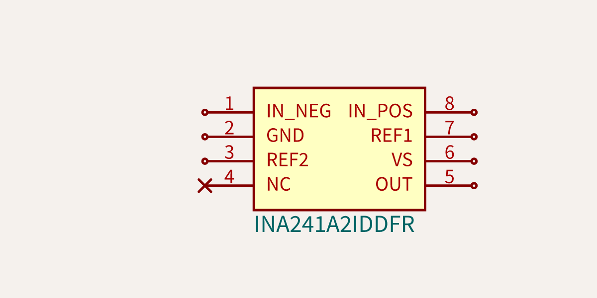
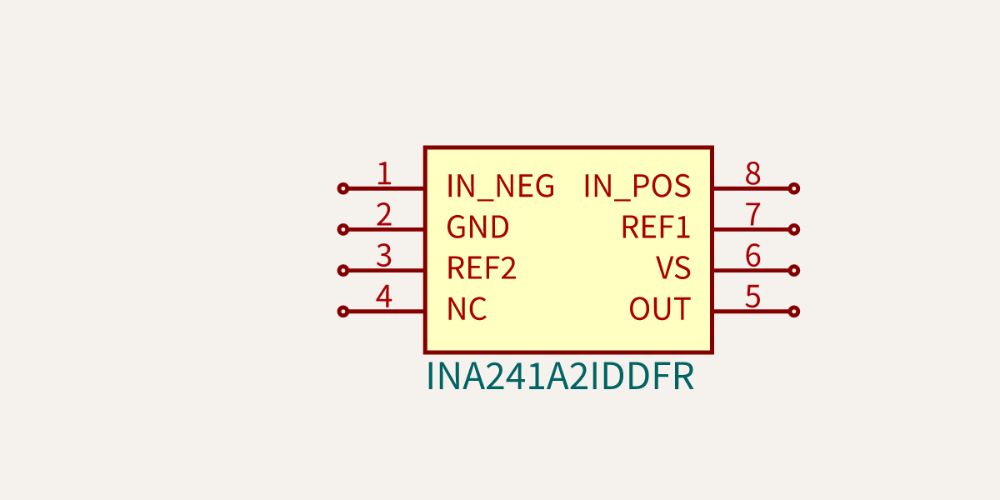

# INA241 NC import defect: separate visual evidence

Upstream fix: [tscircuit/easyeda-converter PR #656](https://github.com/tscircuit/easyeda-converter/pull/656), head `1ba711a8b2af46494e1a8d13b702ecadfd350b30`, based on `9d377ea2d590de8d823718c50929ef7b2441a296`. Proposed fix only; no merge, release or supported fresh CLI import is claimed.

TI SBOSA30D Table 5-1 requires reserved physical pin 4 to be grounded even though its name is NC. The converter's `^NC\d*$` label heuristic incorrectly inferred `doNotConnect: true`. The fix removes that inference, retains power/ground inference, and preserves explicit caller metadata. It does not automatically ground NC pins.

## Before

## After

The untouched public supplier fixture is retained as `C5240853.raweasy.json`. Separate native source, Circuit JSON, PCB SVG and schematic SVG outputs are saved for both versions. `comparison.json` records the pin-4 change and SHA-256 hashes. All native physical and schematic element records compare equal; PCB SVGs are byte-identical. The rendered schematic changes because source-port metadata controls the NC cross and terminal rendering. This component-only diagnostic is not a routed controller or a ground-connectivity test.

The retained `render.ts` and `rasterize.ts` record the exact executed local paths and offline model-fetch stub. To reproduce elsewhere, adjust those paths to an installed converter checkout and this evidence directory. The upstream regression is portable: run `bun test tests/convert-to-ts/C5240853-nc-ground-repro.test.ts --timeout 60000`. The new regression fails twice at the base, then passes with the fix; explicit ground, explicit no-connect, explicit false and empty metadata are covered without changing generated component geometry.

Full final validation: **508 passed, zero failed, 81 snapshots and 4,427 assertions**, with the same 60-second timeout as CI. Focused final tests: four passed and 85 assertions. TypeScript, repository formatting and CJS/declaration builds pass. Logs are retained separately. An initial conversion-suite invocation used the runner's 5-second default and encountered timeouts; the complete final 60-second run supersedes that result.

The active NEMA11 supplier imports and native controller outputs remain untouched. Adoption still requires upstream acceptance/release, a supported fresh import, explicit board grounding of pin 4, pin-mapping checks and electrical/physical qualification.

[TI manufacturer datasheet](https://www.ti.com/lit/ds/symlink/ina241a.pdf)
